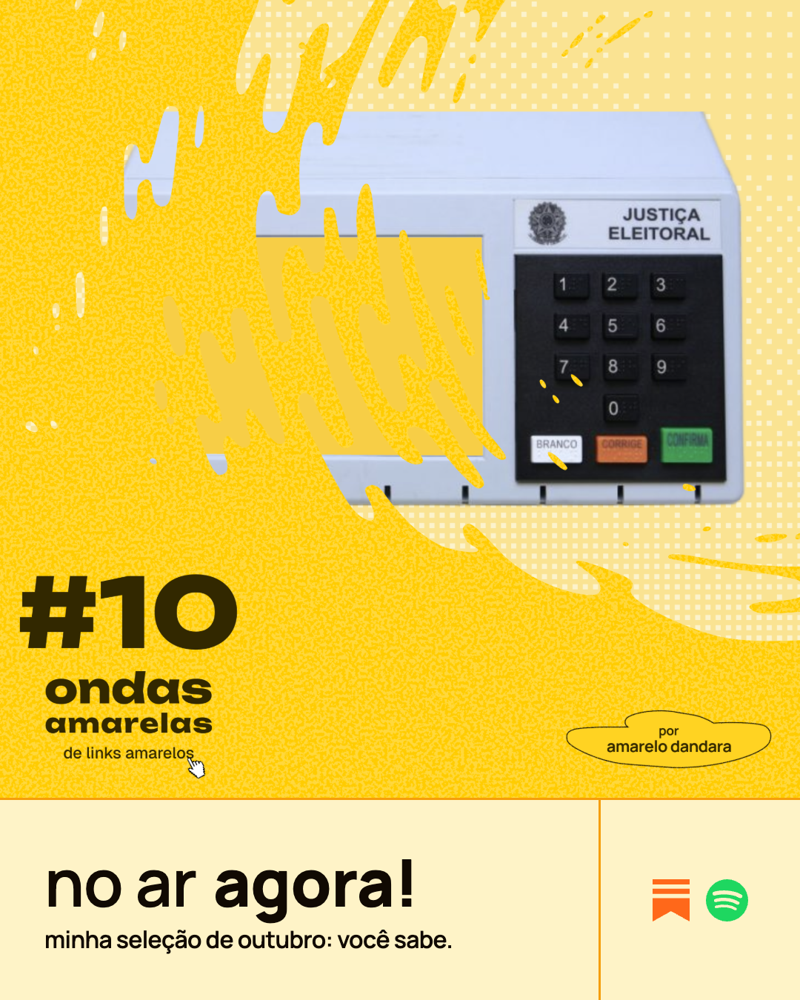
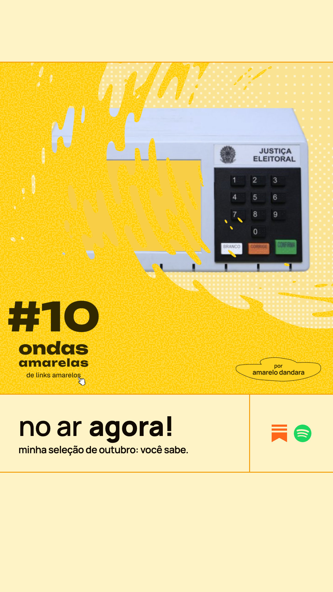
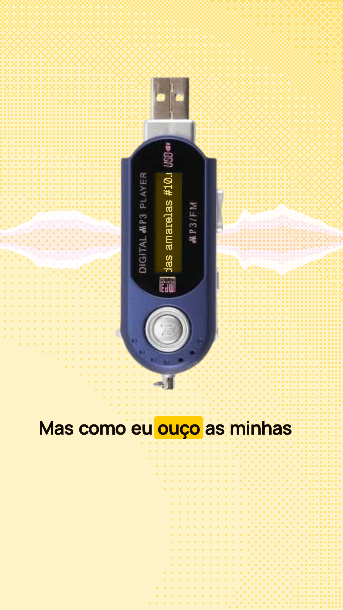
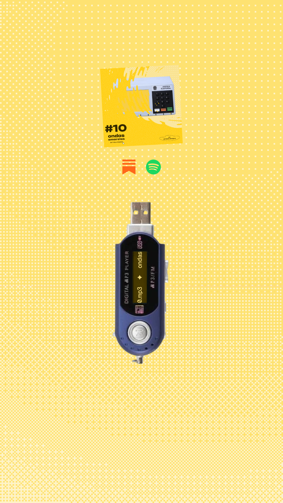

# Catálogo de peças

Os tipos de peça de um lançamento links + ondas, pra escolher qual usar em cada
caso. Cada peça vai ganhar uma skill própria; este catálogo é a versão de
consulta. Regras gerais em `divulgacao.md`, calendário em `ciclo.md`.

## Átomos: de onde as peças saem

Um **átomo** é um trecho do conteúdo que se sustenta sozinho e pode virar peça.
Toda edição tem estes, por causa da estrutura fixa (ver `edicao.md`):

| Átomo | O que é | Exemplo (#10) |
|---|---|---|
| capa | a imagem escolhida do lançamento | a urna eletrônica |
| bloco | um dos 3 blocos: título h3 + a tese | "não existe herói na política" |
| citação | frase forte do texto, que funciona sem contexto | "a gente não precisa que alguém faça alguma coisa, a gente precisa que todo mundo faça uma coisa" |
| link | um link curado + o take da Dandara sobre ele | Onde dá pra conversar |
| trecho | 15 a 60 s do episódio | (sai da transcrição) |
| e digo mais | os 1 ou 2 links leves do fim | The Train Window Archive |

## As peças

Os nomes dizem o papel da peça no lançamento, não o formato. A ordem segue o
momento: D-2, D0, D+. Cada peça tem uma skill (todos 11 a 20 no Solo).

Todo texto das peças e dos posts é da Dandara: escrito por ela na hora ou
copiado literalmente da edição e do episódio (ver `divulgacao.md`). A legenda
do destaque é a transcrição literal da fala, revisada, nunca resumida.

| Peça | Momento | Átomo | Formato | Plataformas | Estado |
|---|---|---|---|---|---|
| teaser | D-2 | conteúdos escolhidos | vídeo 9:16 · stills 1:1 · vídeo 1:1 | IG stories e feed · X · Bluesky | existe (crayola), estrutura vai mudar |
| anúncio ("no ar agora!") | D0 | capa | still 4:5 + still 9:16 · texto com link | IG · Threads · X · Bluesky · Notes (restack) | crayola (`AnuncioFeed`, `AnuncioStories`); skill a fazer |
| episódio completo | D0 | episódio inteiro | vídeo 16:9, capítulos = blocos | YouTube | novo |
| página do episódio | D0, depois do post | edição inteira (feed RSS) | página web | linksamarelos.com | novo |
| destaque | D+ terças | trecho | vídeo 9:16 com legenda | Reels · TikTok · Shorts | crayola (`Destaque`); skill `destaque` |
| resumo | D+ semana 1 | bloco | carrossel IG · 3 posts de texto | IG · Threads | novo |
| curadoria | D+ semana 1 | link | fio de texto | Bluesky · X | novo |
| citação | D+ sábados | citação | card 4:5 · texto | IG feed · Threads · X · Bluesky · Notes | novo |
| link do mês | D+ quintas | link | vídeo 4:5 | IG · Threads · X · Bluesky | protótipo |
| fechamento | D+ semana 3 | e digo mais | card ou texto | IG stories · Notes · Bluesky | novo |

## anúncio

Exemplo com o #10 (só documentação; o subtítulo segue a regra, com "minha"):

| feed 4:5 (1080×1350) | stories 9:16 (1080×1920) |
|---|---|
|  |  |

- **Design**: artboards `anuncio — feed 4:5` e `anuncio — stories 9:16`, página
  Pieces do Paper. Medidas em `settings.json` → `formats.anuncio`.
- **Entra**: capa do episódio, subtítulo da edição e os CTAs (ver `input.md`).
- **Fixo**: "no ar agora!", linhas e cores.
- **CTAs**: só ícones, sem verbo, em linha no quadrado da direita, sempre na
  ordem Substack, Spotify, YouTube. Entram só as plataformas onde o lançamento
  sai. Só Spotify entre os agregadores de podcast: no Brasil a audiência está
  lá.
- **Cores dos ícones**: as do site (Substack `#FF681A`, Spotify `#1ED760`); o
  YouTube, que o site ainda não tem, usa `#FF0000`.
- **Margem**: 60px nas laterais, por causa do recorte 3:4 do grid do
  Instagram.
- **Stories**: 0–200px e abaixo de ~1650px livres pra interface do Instagram.
  O sticker de link é posto no app, logo abaixo da faixa.
- **Onde vai**: feed no IG, Threads e X; stories no IG. Bluesky e Notes não
  levam imagem (cartão do link e restack).
- **Não tem**: versão em vídeo.

## destaque

Exemplo com o #10, trecho 0:00–1:20 (só documentação):

| falando | fim |
|---|---|
|  |  |

- **Design**: artboards `destaque — 1 falando`, `destaque — 2 fim` e
  `destaque — 3 capa do grid` da página Pieces do Paper. Medidas em
  `settings.json` → `formats.destaque`.
- **Entra**: o mp3 do episódio, os tempos de cada trecho (passados pela
  Dandara), a capa e os CTAs (ver `input.md`).
- **Player**: o mp3 player no centro; o visor amarelo tem o letreiro
  "ondas amarelas #N.mp3 ✦" correndo sem parar, em Geist Pixel.
- **Ondas**: forma contínua espelhada, em três azuis (code-light, code,
  code-dark) com mistura overlay. A altura segue o volume da voz (janela de
  0,25 s, escalada pelo próprio trecho); o espectro só dá textura.
- **Legenda**: o que foi falado, palavra por palavra, revisado pela Dandara.
  Páginas de até 6 palavras, quebrando no fim de frase; a palavra falada fica
  marcada em sun.
- **Fim**: 3 s depois do trecho. Em 0,6 s o player encolhe, as ondas
  silenciam e descem a capa inclinada e os ícones dos CTAs.
- **Duração**: a do trecho que a Dandara escolher (o #10 teve 80 s e 90 s).
- **Zonas do Reels**: topo (200px), rodapé (420px) e a lateral direita livres.

## Que peça pra que conteúdo

| Se o conteúdo é… | Use | Por quê |
|---|---|---|
| uma frase pessoal ou política que vale sozinha | citação | lê em 2 segundos, compartilha bem |
| um argumento em partes | resumo | o leitor passa slide a slide acompanhando o raciocínio |
| um momento falado com humor, história ou virada | destaque | a voz carrega o que o texto perde |
| vários links bons do mesmo tema | curadoria | curadoria é o produto; o fio mostra ela inteira |
| um link de ação (site, ferramenta, campanha) | link do mês | o link é o assunto; a peça leva direto pra ele |
| um link com imagem forte (og:image, vídeo, arte) | link do mês | a imagem para o scroll |
| algo leve, fora do tema | fechamento | fecha o ciclo sem repetir o assunto pesado |

Na dúvida entre duas peças, prefira a que leva pra ouvir o episódio: o
objetivo é ouvinte (ver `divulgacao.md`).
