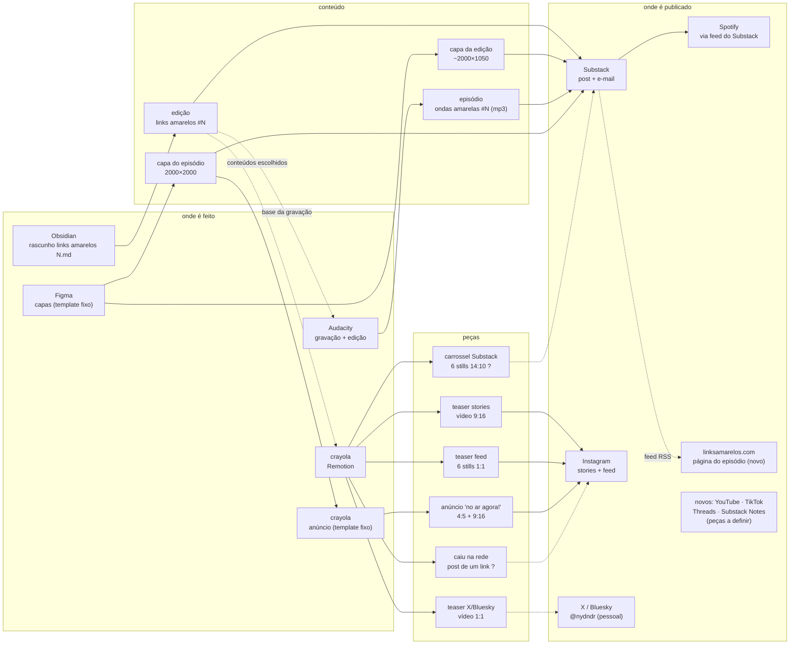
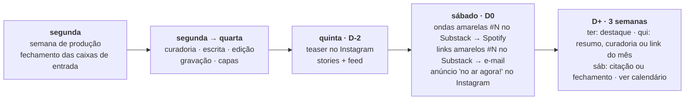
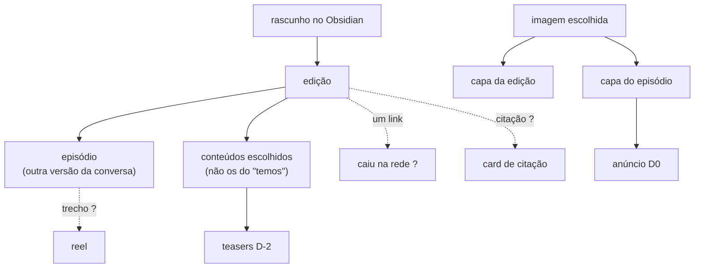

# Ciclo de vida de um lançamento links + ondas

Do fechamento da curadoria até a divulgação depois do lançamento: o que é
conteúdo, o que é peça, onde cada coisa é feita e onde é publicada. Termos em
`glossario.md`, detalhes de cada parte em `edicao.md`.

Legenda: **conteúdo** é o que a marca publica (a edição e o episódio).
**Peça** é o que divulga o conteúdo. Itens com `?` ainda não estão confirmados.

## Mapa: onde nasce, onde vai parar

## Linha do tempo

As datas entre segunda e quinta não estão confirmadas: a nota de processo só
fixa o fechamento na segunda e a ordem dos passos.

## Inventário

| Item | Tipo | Feito em | Formato | Publicado em | Quando | Estado |
|---|---|---|---|---|---|---|
| edição links amarelos #N | conteúdo | Obsidian → Substack | texto + imagens | Substack (post + e-mail) | D0 | ativo |
| episódio ondas amarelas #N | conteúdo | Audacity | mp3, ~15 min | Substack → Spotify | D0, minutos antes da edição | ativo |
| capa da edição | conteúdo | Figma, imagem na máscara | ~2000×1050 | Substack | D0 | ativo |
| capa do episódio | conteúdo | Figma, imagem na máscara | 2000×2000 | Substack, Spotify | D0 | ativo |
| teaser stories | peça | crayola | vídeo 1080×1920 | Instagram stories | D-2 | ativo |
| teaser feed | peça | crayola | 6 stills 1080×1080 | Instagram feed | D-2 | ativo |
| teaser X/Bluesky | peça | crayola | vídeo 1080×1080 | X, Bluesky (@nydndr) | D-2 | gerado, ainda não postado |
| carrossel Substack | peça | crayola | 6 stills 1456×1040 | Substack ? | ? | gerado, uso não confirmado |
| anúncio "no ar agora!" | peça | crayola | stills 1080×1350 (4:5) e 1080×1920 (9:16) | Instagram, Threads, X | D0 | ativo |
| caiu na rede, é link! | peça | crayola | vídeo 1080×1350 | Instagram ? | ? | protótipo, um link da #10 |
| página do episódio no site | conteúdo | site, a partir do feed RSS do Substack | página com os links | linksamarelos.com | depois de D0 | decidido, não existe ainda |
| peças de D+ | peça | crayola (a construir) | ver `catalogo.md` | ver `catalogo.md` | D+ | aprovadas, não existem |

## Plataformas

Decidido em 2026-10-19. As peças de cada plataforma ainda não estão definidas;
a coluna "candidatas" é ponto de partida, não decisão.

| Plataforma | Papel | Peças candidatas | Estado |
|---|---|---|---|
| Substack | casa da edição e do episódio, e-mail | edição, episódio, capas | ativo |
| Spotify | podcast, via feed do Substack | episódio | ativo |
| Instagram | divulgação principal | teasers, anúncio | ativo |
| YouTube | episódio completo + Shorts | episódio em vídeo (capa, waveform, legenda), trechos | novo |
| Substack Notes | divulgação dentro do Substack | citação, link, capa | novo |
| Threads | divulgação em texto, junto do Instagram | citação, link | novo |
| X | divulgação, perfil pessoal @nydndr | teaser 1:1, fio de links, citação | ativo, ainda sem peças |
| Bluesky | divulgação, perfil pessoal @nydndr | teaser 1:1, fio de links, citação | ativo, ainda sem peças |
| TikTok | vídeo curto | trechos do podcast | novo |
| linksamarelos.com | página de cada episódio com os links | gerada do feed do Substack | novo |

Fora por enquanto: WhatsApp, Are.na, LinkedIn, Pinterest. Contas de cada
plataforma em `divulgacao.md`.

## Calendário-base

Aprovado em 2026-10-19. D0 = sábado. Tudo agendado a partir de um lote gerado
no D0 (ver `divulgacao.md`). Peças em `catalogo.md`.

| Quando | O quê |
|---|---|
| qui · D-2 | teaser: IG stories + feed, X, Bluesky, Threads |
| sáb · D0 | anúncio no IG; restack no Notes; post com link no Threads, X e Bluesky; episódio completo no YouTube; página no site |
| semana 1 | ter: destaque 1 · qui: resumo + curadoria · sáb: citação 1 |
| semana 2 | ter: destaque 2 · qui: link do mês 1 · sáb: citação 2 |
| semana 3 | ter: destaque 3 · qui: link do mês 2 · sáb: fechamento |
| semana 4 | sem peças: produção da próxima edição |

Uns 12 a 15 posts por lançamento.

**Distribuição do podcast**: o feed do Substack pode alimentar Apple Podcasts,
Amazon e outros, mas hoje o episódio só chega no Spotify. Ligar os outros é
configuração no Substack, não peça do crayola.

**Página no site**: o feed `amarelodandara.substack.com/feed` traz o HTML
completo de cada post (`content:encoded`), com todos os links inline. A
página de cada episódio no linksamarelos.com pode sair dele depois do
lançamento, sem digitar os links de novo.

## O que alimenta o quê

Uma imagem por lançamento alimenta as duas capas e, por elas, o anúncio. O
texto alimenta o episódio, os teasers e, no futuro, as peças de D+.
